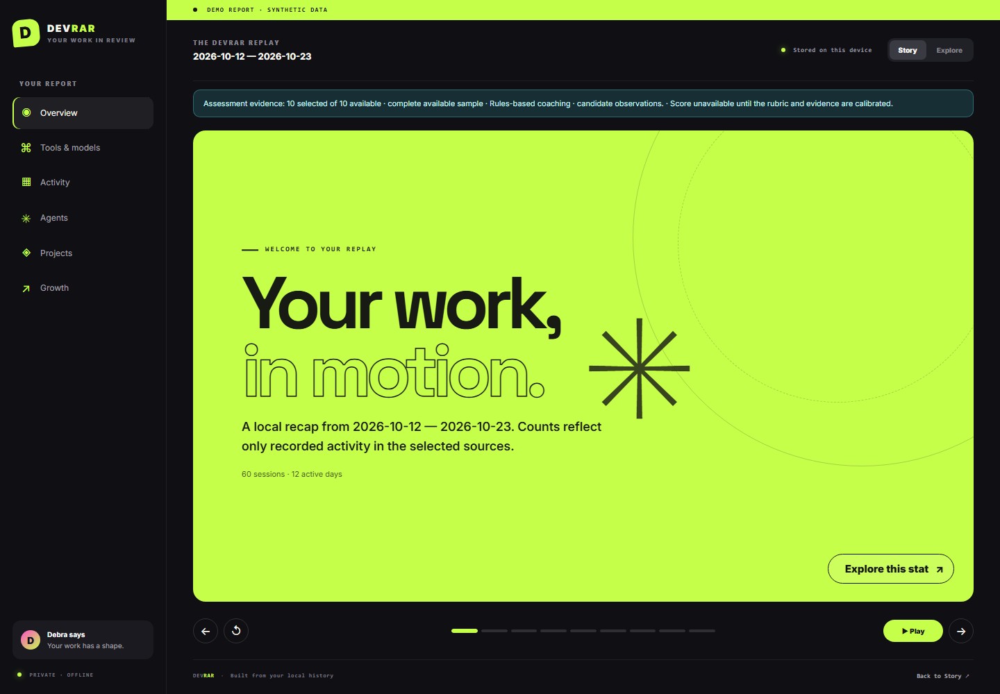

# DevRAR

### Your AI coding, rated and wrapped.

A private, local-first recap of your work with coding agents. Start in your terminal; finish with a colourful, interactive Developer Wrapped in your browser.

**DevRAR 0.2.0 preview.** Recognition and useful feedback have equal weight: recorded activity, an interactive recap and evidence-linked workflow coaching. Numerical engineering grades remain unavailable while rubric calibration and human agreement gates are closed.

## What you get

- A self-contained HTML report with animated Story chapters and a detailed Explore view.
- Local Claude Code / Codex JSONL, OpenCode SQLite, supported Gemini CLI history and Antigravity transcripts/exports, plus explicitly selected Git repositories.
- Separate session, human prompt, assistant response, tool-call and token counters where recorded.
- Source coverage and missing-data explanations instead of invented statistics.
- Five workflow dimensions with cited prompt signals, attribution and alternative explanations.
- Source filters, charts, detail panels, keyboard controls, replay and reduced motion.
- Accessible count-up reveals, working motion pause and preview before saving a share card.
- Calendar heatmaps, hourly prompt patterns, observed-event interval estimates and recorded test execution summaries.
- Source/session check outcomes with exact citations and conditional next actions.
- Compatible baseline comparisons and Git changed-line/file metadata with explicit scope.
- Optional supplied ActivityWatch/CSV time and billed/estimated cost ledgers.
- Personal activity profiles and recorded-fact highlights, with their definitions.
- Private Markdown/JSON evidence artifacts and aggregate-only SVG/PNG share cards.
- An explicitly synthetic demo that never reads your private history.
- Optional local-model coaching with validated citations and no cloud fallback.
- Explicit opt-in cloud coaching, separate native Codex observations and Original/Blue hour themes.
- Recognition badges, opt-in Debra roast and a readable print layout.

## Install from GitHub

Requires Python 3.11+ and Git for repository activity.

~~~console
git clone --branch codex/full-vision-recap https://github.com/train-cell/DevRAR.git
cd DevRAR
python -m venv .venv
~~~

Activate the environment:

~~~powershell
# Windows PowerShell
.\.venv\Scripts\Activate.ps1
~~~

~~~sh
# macOS / Linux
source .venv/bin/activate
~~~

Then install and try the synthetic demo:

~~~console
python -m pip install -e .
devrar wrap --demo --output ./devrar-reports --open
~~~

The package is not published to a package registry yet. These preview instructions use the implementation branch while its pull request is under review.

## Read selected local history

~~~console
devrar wrap --source claude --source codex --repo ./my-project --since 2026-01-01 --until 2026-10-26 --timezone Europe/Athens --output ./devrar-reports --open
~~~

Use repeated --repo options for multiple repositories and --author to limit Git activity to a selected author. Without an author filter, Git totals describe repository activity across authors.

Override discovery with --claude-path or --codex-path. Selecting a path implicitly selects that source. The demo cannot be combined with live sources.

Additional source examples (one line each):

~~~console
devrar wrap --source opencode --source gemini --source antigravity --output ./devrar-reports
devrar wrap --gemini-path ./export.json --since 2026-10-01 --until 2026-10-31
devrar wrap --claude-path ./selected-history --since 2026-10-01 --until 2026-10-31 --compare ./previous-run/apotelesmata.json
devrar wrap --activitywatch-path ./activitywatch.json --cost-path ./ledger.csv --since 2026-10-01 --until 2026-10-31
~~~

Use explicit non-overlapping dates and the same source, repository and author scope for comparisons. Old reports without the required scope metadata remain non-comparable. `--idle-minutes` controls observed-event gap grouping; it does not measure actual PC time. See [expanded recap inputs and limits](docs/expanded-recap.md) for exact supported formats, import examples and compatibility boundaries.

Demo dates are fixed: `--since`, `--until`, `--timezone` and `--author` apply to live runs and cannot be combined with `--demo`.

For compressed Codex rollouts:

~~~console
python -m pip install -e ".[compressed]"
~~~

Missing or unsupported records produce an explicit partial/missing coverage entry. Exit codes are 0 for successful selected coverage, 1 for failure, 2 for invalid arguments and 3 for a useful partial report.

## Optional local coaching

The default rules mode needs no model. If Ollama and a compatible model are already installed, choose its exact name explicitly:

~~~console
devrar wrap --demo --analysis local --local-model YOUR_INSTALLED_MODEL --roast --open
~~~

DevRAR starts its own temporary, cloud-disabled Ollama process on loopback and checks the installed model before sending bounded, redacted excerpts. It never downloads a model. Invalid model proposals preserve the report, display the error and return exit code 3. Read [local analysis](docs/local-analysis.md) for requirements, limits and the trust boundary.

## Optional cloud coaching

Cloud mode requires an explicit HTTPS Chat Completions endpoint, model, API key
environment variable and separate permission to send bounded evidence:

~~~console
devrar wrap --source codex --analysis cloud --cloud-endpoint https://YOUR_PROVIDER/v1/chat/completions --cloud-model YOUR_MODEL --allow-cloud-evidence
~~~

Set `DEVRAR_CLOUD_API_KEY` in your environment, or choose its name with
`--cloud-key-env`. Only bounded redacted evidence fields are sent. Redaction is
not anonymisation: excerpts can contain private work. There is no automatic
cloud fallback. Provider failures preserve local metrics/rules and return 3.
The offline report makes no browser requests. See [provider limits](docs/expanded-recap.md).

## Privacy and honest metrics

Rules-based generation makes no network requests and needs no account or API key. Optional local inference uses a dedicated loopback process. The generated HTML has no external scripts, fonts or analytics. It stays on your device unless you share it.

Private HTML/Markdown/JSON reports may contain selected source labels and evidence locators. The dedicated SVG/PNG share card uses an aggregate allowlist. Inspect any artifact before sharing it.

Every run writes its own Git ignore guard before creating private artifacts, including when a custom output folder is inside another repository.

Sessions, agents and model calls are different counts. No exact PC-hours, actual subscription charges, programmer seniority or global percentile is inferred from conversation timestamps or token volume. Missing values stay unavailable.

The first adapters target documented JSONL shapes and report their coverage. General cloud chat history, inaccessible databases and unknown vendor schemas are not silently treated as analysed. No imported commands are executed.

Coaching uses a bounded sample of redacted excerpts, while activity counts use the full selected stream. Prompt wording is a candidate signal of stated intent, with low confidence; it does not prove execution or code quality. Review [metric definitions and compatibility](docs/metrics.md) and the [observation rubric](docs/rubric.md). Complete Claude API-message usage can provide deduplicated token totals; ambiguous or cumulative usage stays unavailable. Read [usage semantics](docs/usage.md). Demo token values are synthetic.

## Development

~~~console
python -m pip install -e ".[dev,compressed]"
python -m pytest -q -p no:cacheprovider
python -m ruff check src tests
python -m mypy src/devrar --strict
python -m build
~~~

The project uses Greeklish internal identifiers under its workspace conventions; UI copy and public usage documentation are English.

Read [the product brief](DevRAR.md), [the visual brief](DESIGN-BRIEF.md), [the implementation plan](PLAN.md) and [the report contract](docs/report-schema.md) before contributing.

## Brand and assets

Debra is the selected narrator/persona reference. This preview uses original text and a typographic “D” treatment; no television screenshots, clips, actor likenesses or third-party character artwork are bundled.

The shipped UI, inline SVG artwork and synthetic preview are project-authored. Inter, Space Grotesk and JetBrains Mono are bundled with their OFL notices and embedded in each offline HTML report. No vendor artwork is distributed. See [asset provenance](docs/assets.md).

## License

MIT for the code in this repository; bundled fonts use SIL OFL 1.1. See [LICENSE](LICENSE) and [asset provenance](docs/assets.md). Additional third-party assets require their own provenance and applicable license.
